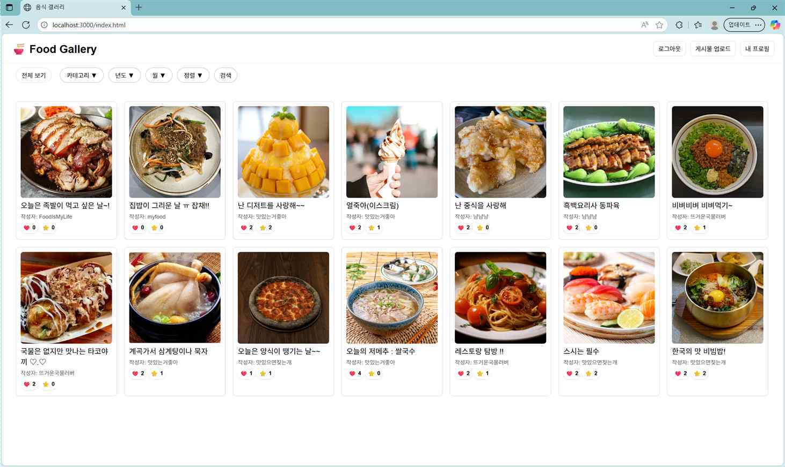
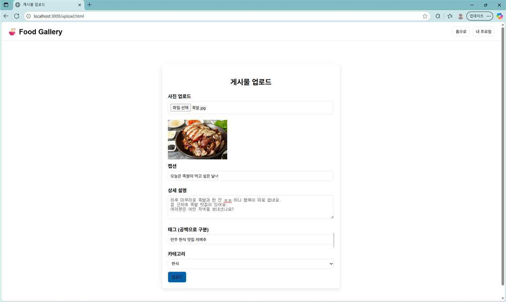
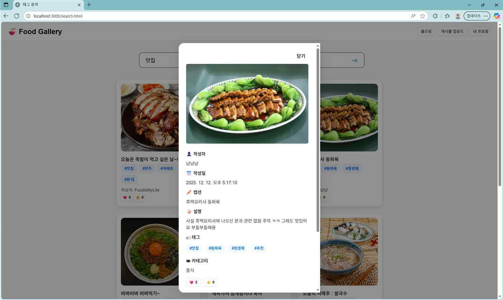
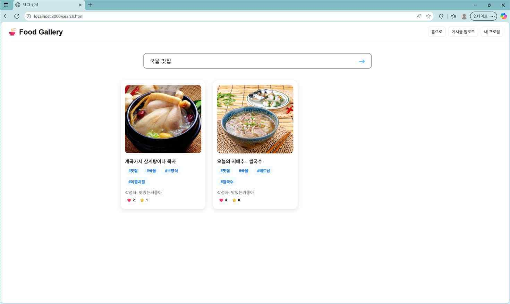
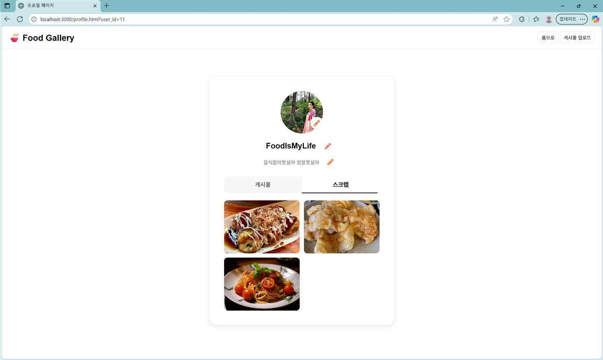
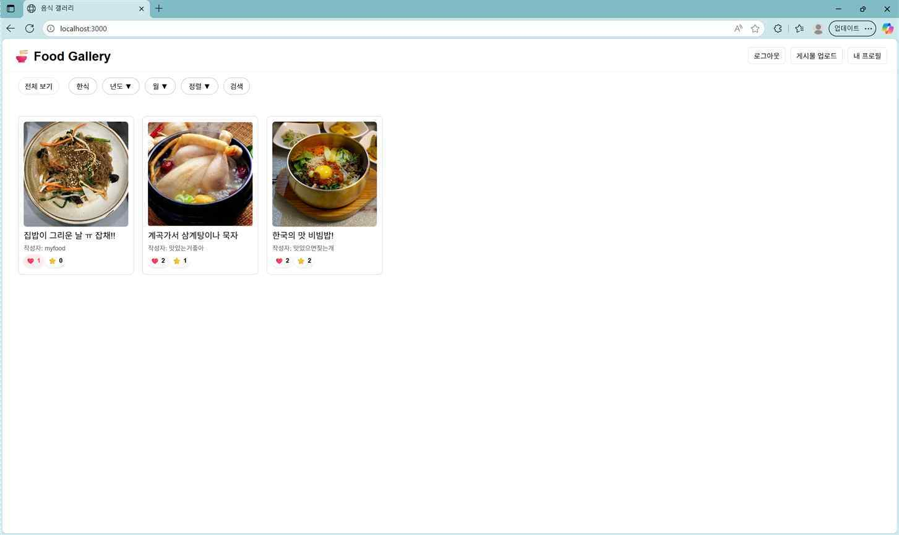
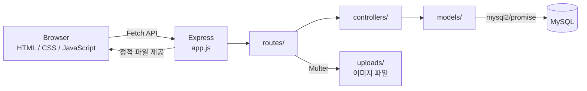
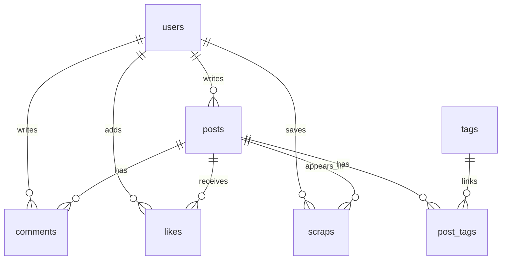

# 🍜 Food Gallery

**음식 사진을 기록하고, 취향에 맞는 게시물을 찾아 공유하는 웹 갤러리**

Food Gallery는 음식 사진에 캡션, 설명, 태그를 붙여 공유하고 좋아요·댓글·스크랩으로 소통하는 웹 애플리케이션입니다. 게시글과 댓글의 CRUD부터 사용자 인증, 프로필 관리, 이미지 업로드, 태그 검색, 복합 필터까지 웹 서비스의 주요 흐름을 구현했습니다.

| 항목 | 내용 |
| --- | --- |
| 프로젝트 | 2025학년도 2학기 웹응용프로그래밍 텀프로젝트 |
| 팀 | 059분반 14팀 |
| 개발자 | 심승우 · 김다형 |
| 저장소 | [dajjangg/WP_2025_14](https://github.com/dajjangg/WP_2025_14) |



## 목차

- [주요 기능](#주요-기능)
- [실행 화면](#실행-화면)
- [기술 스택](#기술-스택)
- [프로젝트 구조](#프로젝트-구조)
- [데이터베이스 설계](#데이터베이스-설계)
- [주요 구현 방식](#주요-구현-방식)
- [로컬 실행 방법](#로컬-실행-방법)
- [API](#api)

## 주요 기능

| 기능 | 구현 내용 |
| --- | --- |
| 회원가입·로그인·로그아웃 | 닉네임 중복 확인, bcrypt 비밀번호 해싱, Passport Local Strategy와 세션 기반 로그인 |
| 게시글 CRUD | 음식 사진, 캡션, 상세 설명, 카테고리, 태그 등록 및 조회·수정·삭제 |
| 게시글 상세 조회 | 모달에서 이미지, 작성자, 작성일, 설명, 태그, 반응 수, 댓글 확인 |
| 댓글 CRUD | 댓글 작성·조회·수정·삭제, 댓글 작성자와 게시글 작성자에 따른 권한 구분 |
| 프로필 수정 | 프로필 이미지, 닉네임, 한 줄 소개 변경 및 닉네임 중복 확인 |
| 좋아요 | 게시글별 좋아요 추가·취소, 좋아요 수와 버튼 상태 갱신 |
| 스크랩·모아보기 | 게시글 저장·취소, 프로필에서 스크랩한 게시물을 저장 시각의 최신순으로 조회 |
| 내 게시글 관리 | 프로필의 게시물 탭에서 작성한 글을 모아보고 상세 모달에서 수정·삭제 |
| 태그 검색 | 태그 클릭 또는 검색어 입력으로 검색, 공백으로 구분한 여러 태그의 교집합 검색 |
| 카테고리·기간 필터 | 한식·중식·양식·일식·기타 카테고리와 작성 연도·월로 게시물 필터링 |
| 게시글 정렬 | 최신순·오래된순·좋아요순 정렬, 메인 갤러리의 카테고리·기간 필터와 함께 적용 |

### 작성자에 따른 수정·삭제 권한

| 대상 | 수정 | 삭제 |
| --- | --- | --- |
| 게시글 | 게시글 작성자 | 게시글 작성자 |
| 댓글 | 댓글 작성자 | 댓글 작성자 또는 해당 게시글 작성자 |

게시글 수정·삭제는 프로필 페이지에서 진행합니다. 수정 화면은 기존 데이터를 불러오며, 새 이미지를 선택하지 않으면 기존 이미지를 유지합니다.

## 실행 화면

텀프로젝트 결과 보고서에 수록된 실제 실행 화면입니다.

<details>
<summary>게시글 업로드·상세 조회·검색·프로필 화면 펼치기</summary>

### 게시글 업로드

사진을 선택하고 캡션, 상세 설명, 태그, 카테고리를 입력합니다. 선택한 사진은 업로드 전에 미리 볼 수 있습니다.



### 게시글 상세 모달

메인 갤러리, 검색 결과, 프로필에서 게시물을 클릭하면 상세 모달을 엽니다. 모달에서 좋아요·스크랩과 댓글 기능을 이용할 수 있습니다.



### 여러 태그로 검색

`국물 맛집`을 입력하면 `국물`과 `맛집` 태그를 모두 가진 게시물만 표시합니다.



### 프로필과 스크랩 모아보기

프로필의 게시물·스크랩 탭을 전환해 내 게시글과 저장한 게시글을 조회합니다. 프로필 이미지, 닉네임, 한 줄 소개도 변경할 수 있습니다.



### 카테고리 필터

카테고리로 원하는 음식 게시물을 찾습니다. 메인 화면에서는 연도·월·정렬 조건을 함께 선택할 수 있습니다.



</details>

## 기술 스택

| 영역 | 기술 | 용도 |
| --- | --- | --- |
| Frontend | HTML, CSS, Vanilla JavaScript | 갤러리, 상세 모달, 프로필 등 사용자 화면 |
| 비동기 통신 | Fetch API, FormData | JSON API 호출, 이미지 전송, 화면 상태 갱신 |
| Backend | Node.js, Express 5 | HTTP 서버, API 라우팅, 정적 파일 제공 |
| 인증 | Passport, passport-local, express-session | Local Strategy와 세션 기반 사용자 인증 |
| 비밀번호 | bcrypt | 비밀번호 해싱 및 로그인 시 검증 |
| Database | MySQL, mysql2/promise | 관계형 데이터 저장, 커넥션 풀 기반 비동기 SQL 처리 |
| 파일 업로드 | Multer | 게시글·프로필 이미지 저장 |
| 개발 도구 | nodemon, dotenv, morgan | 개발 서버 재시작, 환경 변수 관리, 요청 로그 |

## 프로젝트 구조

Express 서버가 `public/`의 프론트엔드와 JSON API를 함께 제공합니다. 서버 코드는 Routes, Controllers, Models로 나누어 요청 경로, 처리 로직, SQL을 분리했습니다.



```text
WP_2025_14/
├── config/
│   ├── db.js                      # MySQL 커넥션 풀
│   └── multer.js                  # 게시글 이미지 업로드 설정
├── controllers/                   # 인증·게시글·댓글·반응·태그·검색 처리
├── middleware/
│   └── authMiddleware.js          # 로그인 여부 확인
├── models/                        # 기능별 SQL 및 데이터 접근
├── passport/
│   └── localStrategy.js           # 로그인 전략, 사용자 직렬화·역직렬화
├── public/
│   ├── index.html                 # 메인 갤러리, 필터, 정렬
│   ├── login.html                 # 로그인
│   ├── register.html              # 회원가입
│   ├── upload.html                # 게시글 작성·수정
│   ├── search.html                # 태그 검색
│   └── profile.html               # 프로필 수정, 내 게시글·스크랩 조회
├── routes/                        # 기능별 API 경로 및 미들웨어 연결
├── test_images/                   # 업로드 테스트용 이미지
├── database_making_script.txt     # DB·테이블 생성 SQL
├── test.http                      # HTTP 요청 예시
├── app.js                         # Express 설정, 세션, 라우터 연결
├── index.js                       # 서버 실행 진입점
├── package.json
└── package-lock.json
```

`routes/`, `controllers/`, `models/`에는 인증·사용자(`auth`/`user`), 게시글(`post`), 댓글(`comment`), 좋아요(`like`), 스크랩(`scrap`), 태그(`tag`), 검색(`search`) 관련 파일이 있습니다. 실행에 필요한 `.env`와 이미지 저장용 `uploads/`는 로컬에서 생성합니다.

## 데이터베이스 설계

MySQL의 `wp_project` 데이터베이스에 7개 테이블을 구성했습니다. 전체 생성 쿼리는 [database_making_script.txt](database_making_script.txt)에서 확인할 수 있습니다.

| 테이블 | 기본 키 | 저장 내용 |
| --- | --- | --- |
| `users` | `user_id` | 닉네임, 비밀번호 해시, 프로필 이미지 경로, 한 줄 소개 |
| `posts` | `post_id` | 작성자, 이미지 경로, 캡션, 설명, 카테고리, 좋아요·스크랩 수, 작성 시각 |
| `comments` | `comment_id` | 게시글, 댓글 작성자, 댓글 내용, 작성 시각 |
| `likes` | `(post_id, user_id)` | 사용자별 게시글 좋아요 관계 |
| `scraps` | `(post_id, user_id)` | 사용자별 게시글 저장 관계, 저장 시각 |
| `tags` | `tag_id` | 중복되지 않는 태그 이름 |
| `post_tags` | `(post_id, tag_id)` | 게시글과 태그의 연결 관계 |



- **게시글과 태그의 N:N 관계**: `post_tags`를 연결 테이블로 사용해 하나의 게시글에 여러 태그를 지정하고, 같은 태그를 여러 게시글에서 재사용합니다.
- **사용자별 반응 관리**: `likes`와 `scraps`의 복합 기본 키로 동일 사용자가 같은 게시글에 중복 등록되는 것을 제한합니다.
- **연관 데이터 관리**: 외래 키의 `ON DELETE CASCADE`로 게시글 삭제 시 관련 댓글, 좋아요, 스크랩, 태그 연결 데이터를 함께 삭제합니다.
- **이미지 저장 분리**: 실제 파일은 서버의 `uploads/`에 저장하고, 데이터베이스에는 이미지 경로를 저장합니다.

## 주요 구현 방식

### 1. 세션 기반 인증과 작성자 권한 확인

[Local Strategy](passport/localStrategy.js)에서 닉네임으로 사용자를 조회하고 bcrypt로 비밀번호를 검증합니다. 로그인 후 세션에는 사용자 ID를 직렬화하고, 이후 요청에서 사용자 정보를 다시 조회합니다.

[인증 미들웨어](middleware/authMiddleware.js)는 게시글·댓글 변경과 좋아요·스크랩 토글 요청의 로그인 여부를 확인합니다. 게시글 수정·삭제는 컨트롤러에서 작성자를 확인하고, 댓글 수정은 작성자 조건을 포함한 SQL로 처리합니다. 댓글 삭제는 댓글 작성자 또는 게시글 작성자에게 허용합니다.

### 2. 여러 태그를 모두 만족하는 검색

[searchModel.js](models/searchModel.js)는 입력한 태그를 `IN` 조건으로 찾은 뒤 게시글별로 묶습니다. `COUNT(DISTINCT t.tag_name)`으로 일치한 태그 수를 계산하고, `HAVING match_count = ?`로 입력한 태그를 모두 가진 게시물만 반환합니다.

예를 들어 `국물 맛집`을 검색하면 두 태그 중 하나만 가진 글은 제외됩니다. 게시물의 태그를 클릭해도 같은 검색 화면으로 이동합니다.

### 3. 메인 갤러리의 복합 필터와 정렬

[index.html](public/index.html)에서 전체 게시물을 불러온 뒤 카테고리, 작성 연도, 작성 월을 순서대로 필터링하고 최신순·오래된순·좋아요순 정렬을 적용합니다. 필터와 정렬은 브라우저에서 처리합니다.

### 4. 비동기 요청과 화면 갱신

좋아요·스크랩은 동일한 API로 추가와 취소를 처리하는 토글 방식입니다. Fetch API로 요청한 뒤 버튼 상태와 개수를 갱신하며, 댓글도 작성·수정·삭제 후 목록을 다시 불러옵니다. 이미지 전송에는 `FormData`를 사용합니다.

## 로컬 실행 방법

### 준비 사항

- Node.js 18 이상 및 npm: Express 5와 bcrypt 6의 최소 Node.js 요구 버전 기준
- 실행 중인 MySQL 서버와 데이터베이스 접근 계정

### 1. 저장소 복제 및 패키지 설치

```bash
git clone https://github.com/dajjangg/WP_2025_14.git
cd WP_2025_14
npm ci
mkdir uploads
```

`uploads/`는 프로젝트 루트에 생성합니다. 게시글 이미지와 프로필 이미지가 이 디렉터리에 저장됩니다.

### 2. 데이터베이스 생성

프로젝트 루트에서 MySQL 클라이언트에 접속합니다.

```bash
mysql -u root -p
```

MySQL 프롬프트에서 생성 스크립트를 실행합니다.

```sql
SOURCE database_making_script.txt;
```

스크립트는 `wp_project` 데이터베이스와 7개 테이블을 생성합니다. 테이블 생성용 스크립트이므로 실행 후 회원가입과 게시글 업로드로 데이터를 추가합니다.

### 3. 환경 변수 설정

프로젝트 루트에 `.env` 파일을 생성합니다.

```dotenv
PORT=3000
DB_HOST=localhost
DB_PORT=3306
DB_USER=root
DB_PASSWORD=your_mysql_password
DB_DATABASE=wp_project
COOKIE_SECRET=replace_this_with_a_long_random_value
```

`DB_USER`와 `DB_PASSWORD`는 사용할 MySQL 계정으로, `COOKIE_SECRET`은 세션 서명에 사용할 임의의 긴 문자열로 변경합니다.

### 4. 서버 실행

```bash
npm start
```

`npm start`는 `nodemon index.js`를 실행합니다. 브라우저에서 [http://localhost:3000/index.html](http://localhost:3000/index.html)에 접속합니다.

### 5. 기능 사용 흐름

1. 메인 화면에서 로그인 페이지로 이동해 회원가입 후 로그인합니다.
2. **게시물 업로드**에서 음식 사진, 캡션, 설명, 태그, 카테고리를 등록합니다.
3. 갤러리의 게시물을 클릭해 상세 내용을 확인하고 댓글, 좋아요, 스크랩을 사용합니다.
4. 태그를 클릭하거나 검색창에 공백으로 구분한 태그를 입력해 게시물을 찾습니다.
5. 메인 화면에서 카테고리·연도·월 필터와 정렬을 적용합니다.
6. **내 프로필**에서 프로필을 수정하고, 내 게시글을 관리하거나 스크랩한 글을 모아봅니다.

### 실행 참고

- 로그인·회원가입 페이지의 요청 주소와 CORS 설정이 `http://localhost:3000`을 기준으로 작성되어 있으므로, 기본 실행 포트는 `3000`을 사용합니다. 포트를 변경할 때는 [login.html](public/login.html), [register.html](public/register.html)의 요청 주소와 [app.js](app.js)의 CORS 설정도 함께 변경합니다.
- 게시글 이미지 업로드는 [config/multer.js](config/multer.js)에서 파일당 최대 10MB로 제한합니다.
- 연도 필터의 선택지는 [index.html](public/index.html)에 정의되어 있습니다. 다른 연도의 데이터를 조회하려면 해당 선택지를 추가할 수 있습니다.
- `.env`와 `uploads/`는 `.gitignore`에 등록되어 있습니다. 예시 음식 사진은 `test_images/`를 활용할 수 있습니다.

## API

모든 경로는 Express 서버의 기본 주소를 기준으로 합니다. 일반 데이터는 JSON으로, 이미지 업로드는 `multipart/form-data`로 전송합니다.

<details>
<summary>주요 API 목록 펼치기</summary>

| 구분 | Method | Endpoint | 설명 |
| --- | --- | --- | --- |
| 인증 | POST | `/auth/register` | 회원가입 |
| 인증 | POST | `/auth/login` | 로그인 |
| 인증 | POST | `/auth/logout` | 로그아웃 |
| 인증 | GET | `/auth/status` | 현재 로그인 상태 확인 |
| 프로필 | GET | `/auth/me` | 로그인한 사용자의 프로필 정보와 게시글·스크랩 수 조회 |
| 프로필 | GET | `/auth/:user_id/profile` | 사용자 정보, 작성한 게시글, 스크랩한 게시글 조회 |
| 프로필 | POST | `/auth/:user_id/profile/image` | 프로필 이미지 변경 |
| 프로필 | POST | `/auth/:user_id/profile/username` | 닉네임 변경 |
| 프로필 | POST | `/auth/:user_id/profile/intro` | 한 줄 소개 변경 |
| 게시글 | GET | `/post` | 전체 게시글 조회 |
| 게시글 | GET | `/post/:post_id` | 게시글 상세 조회 |
| 게시글 | POST | `/post/upload` | 이미지와 게시글 등록 |
| 게시글 | PUT | `/post/:post_id` | 게시글 수정 |
| 게시글 | DELETE | `/post/:post_id` | 게시글 삭제 |
| 댓글 | GET | `/comment/:post_id` | 게시글의 댓글 목록 조회 |
| 댓글 | POST | `/comment/:post_id` | 댓글 작성 |
| 댓글 | PUT | `/comment/:comment_id` | 댓글 수정 |
| 댓글 | DELETE | `/comment/:comment_id` | 댓글 삭제 |
| 좋아요 | POST | `/like/:post_id` | 좋아요 추가·취소 |
| 좋아요 | GET | `/like/:post_id/count` | 좋아요 수 조회 |
| 스크랩 | POST | `/scrap/:post_id` | 스크랩 추가·취소 |
| 스크랩 | GET | `/scrap/:post_id/count` | 스크랩 수 조회 |
| 검색 | GET | `/search?q=태그1%20태그2` | 여러 태그를 모두 포함하는 게시글 검색 |
| 태그 | GET | `/tag` | 전체 태그 목록 조회 |
| 태그 | GET | `/tag/:tag_id/posts` | 태그 ID로 게시글 조회 |
| 태그 | GET | `/tag/name/:tag_name/posts` | 태그 이름으로 게시글 조회 |

게시글·댓글 변경과 좋아요·스크랩 토글 API는 로그인이 필요합니다. 게시글 작성·수정의 이미지 필드명은 `image`, 프로필 이미지 변경의 필드명은 `profile_image`입니다.

</details>
